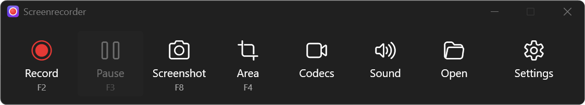
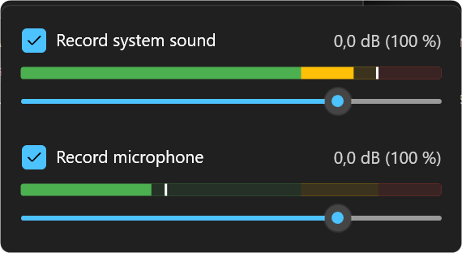
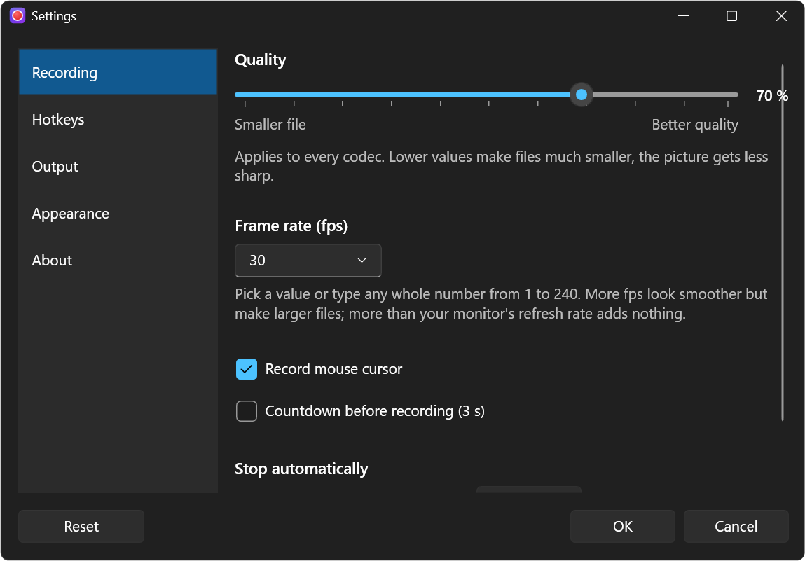
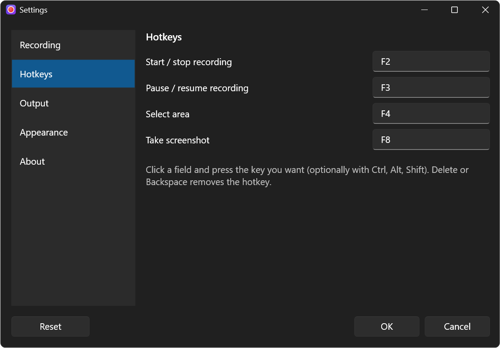
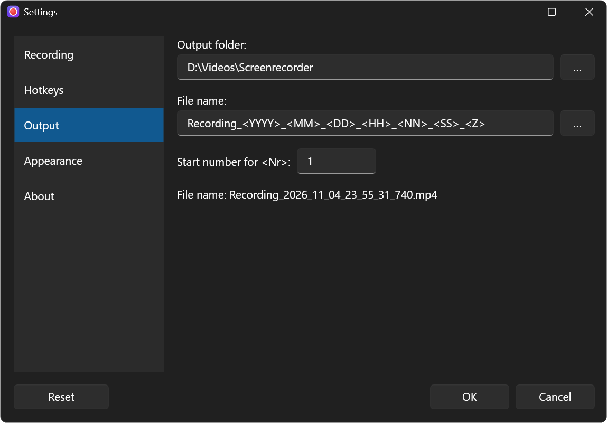
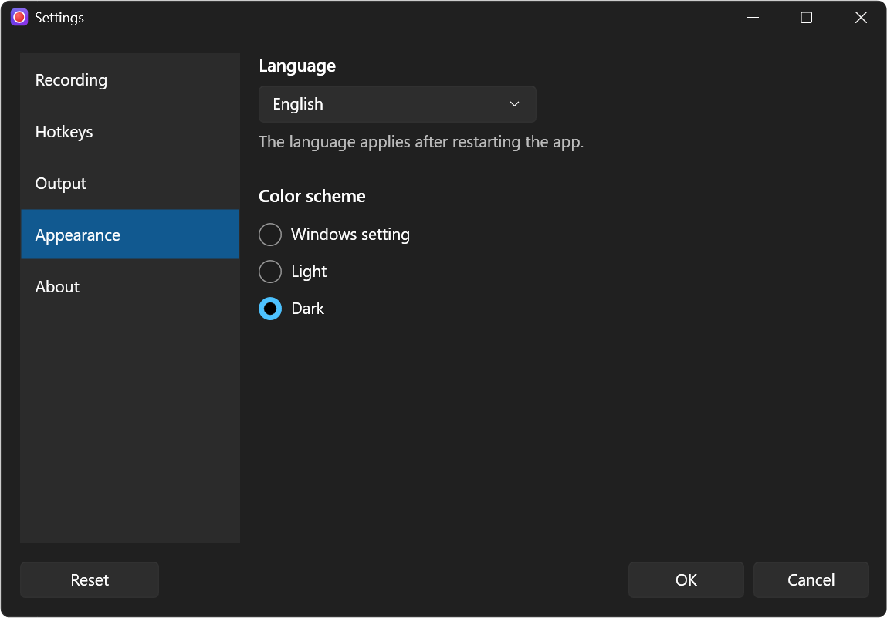

# Screenrecorder

Lean screen recorder for Windows 11 with GPU encoding (NVIDIA NVENC incl. RTX 50, Intel Quick Sync, AMD AMF),
a freely definable capture area, and system sound + microphone.



## Features

- **Area**: movable frame with presets (YouTube 720p/1080p, 16:9, 4:3), custom sizes, drag to select an area,
  primary screen, second screen, full desktop
- **Select area** suggests the window or window part under the mouse while hovering (e.g. the web page area in a
  browser); click to accept, drag to draw freely
- **Record a window** (Area menu): records one specific window, even if it is moved or covered.
  Windows only delivers the first frame once something changes in the window; until then the control bar shows
  "Waiting for a picture – move the mouse over the window".
- **Screenshot** (button "Screenshot", **F8**): PNG to the output folder and to the clipboard
- **Crash-safe**: the MP4 is written continuously in fragments; if the app or PC crashes, everything except the last
  ~2 s stays playable. Free disk space is checked before and during recording.
- **Countdown** 3-2-1 before starting (optional, in the settings), **automatic stop** after X minutes or X MB
- **Tray icon** with a menu and a Windows notification after every recording/screenshot (click opens the folder with
  the file selected). Minimizing the window while not recording also hides the frame.
- **While recording**: elapsed time and current file size in the window and the title bar. A small control bar
  (time, size, pause/resume, stop) sits at the bottom left of the frame, or top left if there is no room below;
  it is never recorded. The frame is red while recording and orange while paused.
- **Codecs**: H.264 / H.265 / AV1 via NVENC, Quick Sync, AMF, Windows Media Foundation, SVT-AV1 (CPU).
  Every encoder is checked with a test encode at startup; only what works on the machine is shown.
- **Sound**: system sound (WASAPI loopback) and microphone, mixed, as Opus
- **Audio mixer** (button "Sound"): on/off per source, level meter (green/yellow/red) and volume −40 … **+12 dB (400 %)**;
  adjustable during recording too, double-click the slider to reset to 0 dB
- **Pause**: pause and resume a recording; the result is a single file
- **Hotkeys** (global, configurable in the settings): **F2** start/stop recording, **F3** pause/resume,
  **F4** select area, **F8** screenshot; the current hotkey is shown under each button
- **Settings**: quality slider (smaller file ↔ better quality), frame rate (presets 24–240 fps or any value 1–240),
  mouse cursor on/off, hotkeys, output folder and file name with placeholders
  (`<YYYY> <MM> <DD> <HH> <NN> <SS> <Z> <Nr>`), language (German/English), color scheme (Windows/Light/Dark),
  About with licenses
- Default output: `%USERPROFILE%\Videos\Screenrecorder\Recording_YYYY_MM_DD_hh_mm_ss_zzz.mp4`
  (`Aufnahme_…` when the app runs in German)



### Settings

| Recording | Hotkeys |
|---|---|
|  |  |
| **Output** | **Appearance** |
|  |  |

## Installation

Download `Screenrecorder-vX.Y.Z.exe` from the release and run it, that's all. The embedded LGPL `ffmpeg.exe` is
extracted to `%LOCALAPPDATA%\Screenrecorder\ffmpeg\<version>\` on first start.
An `ffmpeg.exe` of your own next to the EXE takes precedence.

## Notes

- Sound is stored as **Opus** (royalty-free). VLC, browsers, YouTube and modern video editors play it;
  older players or editors may not.
- Recordings within one monitor run entirely on the GPU via **Windows Graphics Capture**, on every monitor and
  every graphics card. The picture is sampled at up to 240 Hz and evenly converted to the chosen frame rate;
  measured motion is clearly smoother than with Desktop Duplication (`tools/motion-test`). Without gfxcapture in
  ffmpeg the app falls back to Desktop Duplication.
- An area spanning several monitors, or "Full screen (all monitors)" with more than one monitor, uses GDI capture
  (more CPU load).

## Development

Requirements: .NET 10 SDK, `ffmpeg`/`ffprobe` on the `PATH` for the integration tests.

```powershell
dotnet build
dotnet test --filter "Category!=Integration"   # fast unit tests (as in CI)
dotnet test                                    # incl. real recording + A/V sync measurement
dotnet run --project src/Screenrecorder
```

The A/V sync measurement briefly shows a white window at the top left and plays a quiet tone.

Measure motion smoothness (needs Python 3 and Edge; the test window must stay in the foreground):

```powershell
powershell -File tools/motion-test/run.ps1
```

## Release

```powershell
git tag v0.2.0
git push origin v0.2.0
```

The GitHub Action downloads an LGPL `ffmpeg.exe` (and aborts on a GPL build), embeds it together with its license
text, and publishes a self-contained single-file EXE plus `THIRD-PARTY-NOTICES.md` as a GitHub Release.
Local builds embed nothing and use `ffmpeg` from the `PATH`.

The app icon is generated with `dotnet run tools/make-icon.cs -- src/Screenrecorder/Assets/app.ico preview.png`.

## License

Proprietary, all rights reserved (see `LICENSE`). Third-party components: `THIRD-PARTY-NOTICES.md`.
