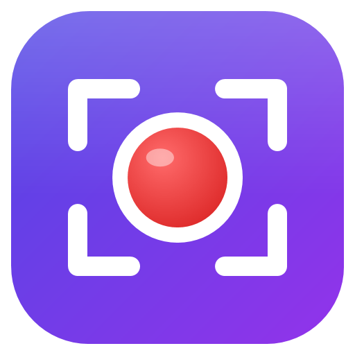
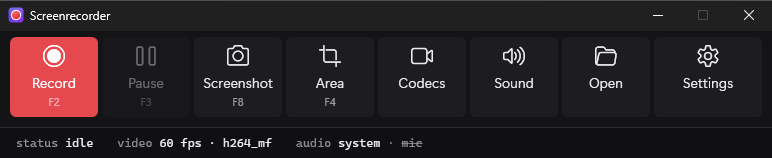
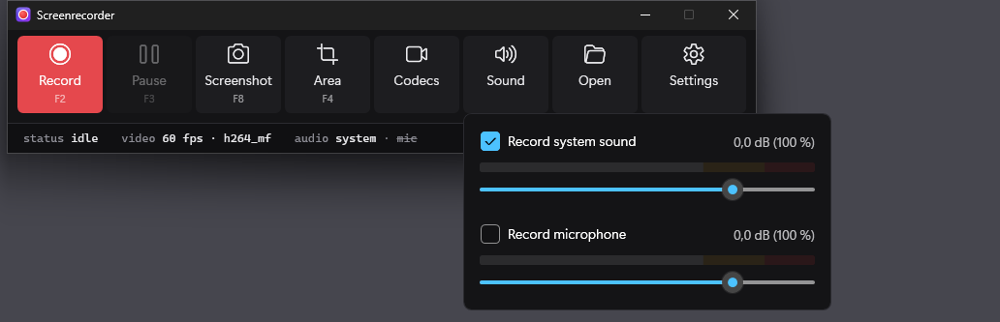
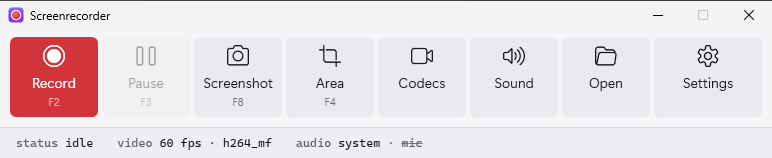
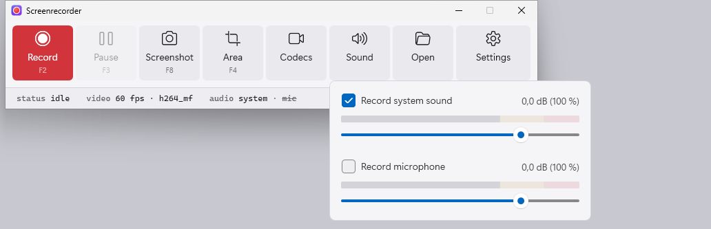
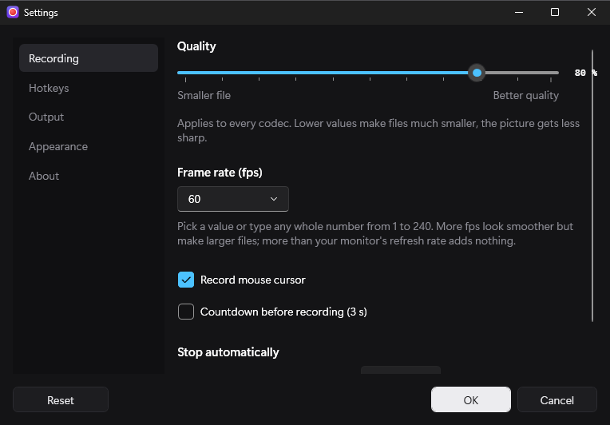
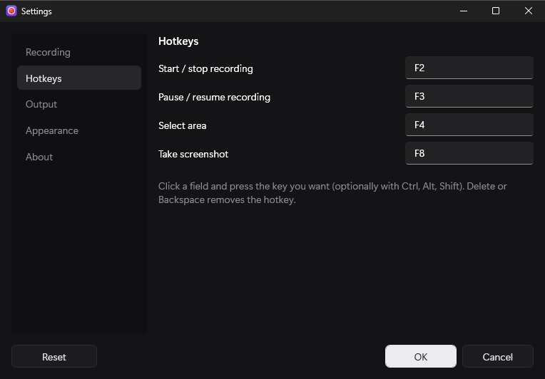
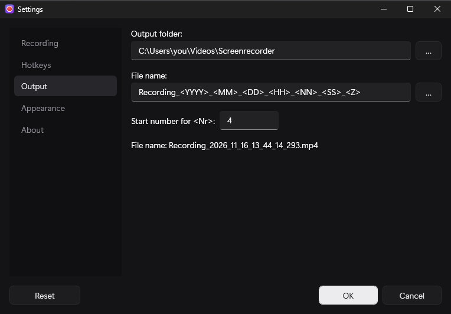
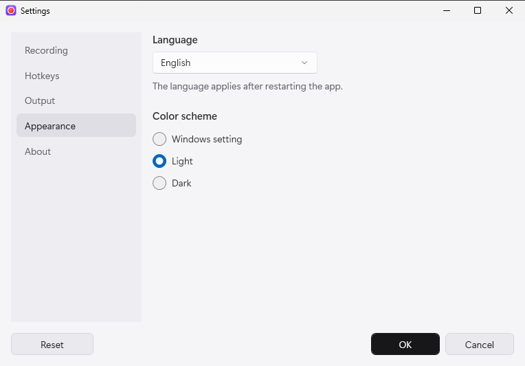

<p align="center">
  
</p>

<h1 align="center">Screenrecorder</h1>

<p align="center">
  <b>Record any area of your screen with GPU encoding, system sound and microphone.</b><br>
  A lean Windows 11 screen recorder: one EXE, no installer, the encoder is picked for you.
</p>

<p align="center">
  
  
  
</p>

<p align="center">
  
</p>

## What is it?

Most screen recorders either do too much or hide the one setting you need. Screenrecorder does the
common job well:

- **Pick** what to record: a movable frame, a window, one monitor or everything.
- **Record** with a hotkey, with the GPU doing the encoding, so the game or the desktop keeps running smoothly.
- **Keep** the result: the MP4 is written continuously, so a crash costs you about two seconds, not the clip.

It is a single `.exe`, needs no installer, and finds a working encoder on its own.

> Red always means "record": the Record button, the frame while recording, the status bar. Everything else is
> neutral graphite (dark) or paper (light). The status bar under the buttons shows the current settings at a glance.

## Features

| | |
|---|---|
| **Area** | Movable frame with presets (YouTube 720p/1080p, 16:9, 4:3), custom sizes, drag to select, primary screen, second screen or the full desktop. |
| **Select area** | Suggests the window or window part under the mouse while hovering (e.g. the page area in a browser); click to accept, drag to draw freely. |
| **Record a window** | Records one specific window, even if it is moved or covered. Windows delivers the first frame only once something changes; until then the control bar says "Waiting for a picture". |
| **Codecs** | H.264, H.265 and AV1 via NVENC, Quick Sync, AMF, Windows Media Foundation, or SVT-AV1 on the CPU. Every encoder is test-encoded at startup; only what works on your machine is shown. |
| **Sound** | System sound (WASAPI loopback) and microphone, mixed, stored as Opus. |
| **Audio mixer** | On/off per source, level meter (green, yellow, red) and volume from −40 to **+12 dB (400 %)**. Adjustable while recording; double-click a slider to reset it. |
| **Pause** | Pause and resume; the result is still a single file. |
| **Screenshot** | PNG to the output folder and the clipboard. |
| **Crash-safe** | The MP4 is written in fragments; after a crash everything except the last ~2 s stays playable. Free disk space is checked before and during recording. |
| **Limits and countdown** | Optional 3-2-1 countdown, automatic stop after X minutes or X MB. |
| **While recording** | Elapsed time and file size in the window and title bar. A small control bar (time, size, pause, stop) sits at the corner of the frame and is never recorded. The frame is red while recording and orange while paused. |
| **Tray and notices** | Tray icon with a menu and a Windows notification after every recording or screenshot; a click opens the folder with the file selected. |
| **Global hotkeys** | Defaults: `F2` start/stop, `F3` pause/resume, `F4` select area, `F8` screenshot. Configurable in Settings; the current key is shown under each button. |
| **Light and dark theme** | Windows setting, Light or Dark; the window follows the system live. |
| **Languages** | English and German. |



## Quick tour

1. Start `Screenrecorder.exe`. The frame shows the area; drag it or pick a preset under **Area**.
2. Press **Record** (or `F2`). Press it again to stop; the notification opens the folder.
3. **Sound** opens the mixer: choose system sound, microphone or both and set the levels.
4. **Settings** has quality, frame rate, hotkeys, output folder, file name and theme.

Default output: `%USERPROFILE%\Videos\Screenrecorder\Recording_YYYY_MM_DD_hh_mm_ss_zzz.mp4`
(`Aufnahme_…` when the app runs in German). The file name accepts the placeholders
`<YYYY> <MM> <DD> <HH> <NN> <SS> <Z> <Nr>`.

<table>
  <tr>
    <td width="50%" align="center"><br><sub>Main window, light theme</sub></td>
    <td width="50%" align="center"><br><sub>Audio mixer, light theme</sub></td>
  </tr>
  <tr>
    <td width="50%" align="center"><br><sub>Settings: Recording</sub></td>
    <td width="50%" align="center"><br><sub>Settings: Hotkeys</sub></td>
  </tr>
  <tr>
    <td width="50%" align="center"><br><sub>Settings: Output</sub></td>
    <td width="50%" align="center"><br><sub>Settings: Appearance, light theme</sub></td>
  </tr>
</table>

## How it works

1. **Capture:** [ffmpeg](https://ffmpeg.org) grabs the picture. Within one monitor it uses **Windows Graphics Capture**
   entirely on the GPU, on every monitor and graphics card. The picture is sampled at up to 240 Hz and evenly
   converted to the chosen frame rate; measured motion is clearly smoother than with Desktop Duplication
   (`tools/motion-test`).
2. **Fallbacks:** without gfxcapture in ffmpeg it uses Desktop Duplication. Without a Direct3D 11 device at all
   (for example in a virtual machine) it uses GDI capture. An area spanning several monitors also uses GDI,
   with more CPU load.
3. **Encode:** the encoder chosen under **Codecs** runs on the GPU where possible.
4. **Audio:** system sound and microphone are captured with WASAPI, mixed with your levels and muxed as Opus.

## Requirements

- Windows 11, 64-bit.
- A GPU with a hardware encoder is recommended; the CPU encoder SVT-AV1 works without one.
- To build from source: the [.NET 10 SDK](https://dotnet.microsoft.com/download).

## Installation

Download `Screenrecorder.exe` from the [latest release](../../releases/latest) and run it, that's all. The embedded
LGPL `ffmpeg.exe` is extracted to `%LOCALAPPDATA%\Screenrecorder\ffmpeg\<version>\` on first start.
An `ffmpeg.exe` of your own next to the EXE takes precedence.

## Good to know

- Sound is stored as **Opus** (royalty-free). VLC, browsers, YouTube and modern video editors play it;
  older players or editors may not.
- **SmartScreen:** the executable is not code-signed, so Windows may show a warning on first run.
- Settings are stored in `%APPDATA%\Screenrecorder\settings.json`.

## Build from source

Requirements: .NET 10 SDK, `ffmpeg`/`ffprobe` on the `PATH` for the integration tests.

```powershell
dotnet build
dotnet test --filter "Category!=Integration"   # fast unit tests (as in CI)
dotnet test                                    # incl. real recording + A/V sync measurement
dotnet run --project src/Screenrecorder
```

The A/V sync measurement briefly shows a white window at the top left and plays a quiet tone. The integration tests
also pass on machines without a GPU (they fall back to GDI capture with a looser sync limit).

Measure motion smoothness (needs Python 3 and Edge; the test window must stay in the foreground):

```powershell
powershell -File tools/motion-test/run.ps1
```

## Releases

```powershell
git tag v0.5.0
git push origin v0.5.0
```

The GitHub Action downloads an LGPL `ffmpeg.exe` (and aborts on a GPL build), embeds it together with its license
text, and publishes a self-contained single-file EXE plus `THIRD-PARTY-NOTICES.md` as a GitHub Release.
Local builds embed nothing and use `ffmpeg` from the `PATH`.

The README screenshots are taken with `powershell -File tools/shoot.ps1` (run `dotnet build` first).
The app icon is generated with `dotnet run tools/make-icon.cs -- src/Screenrecorder/Assets/app.ico docs/screenshots/icon.png`.

## Project layout

| Path | What |
|---|---|
| `src/Screenrecorder` | WPF app: windows, recording, capture, encoders, audio |
| `src/Screenrecorder/Themes` | Dark and light colour palettes |
| `tests/Screenrecorder.Tests` | Unit and integration tests (real recordings, A/V sync) |
| `tools` | Motion test, icon generator, screenshot script |
| `docs/screenshots` | The images above |

## License

Proprietary, all rights reserved (see `LICENSE`). Third-party components: `THIRD-PARTY-NOTICES.md`.
